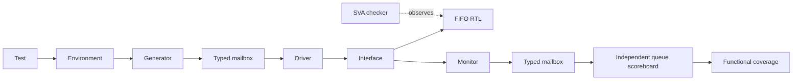

# Synchronous FIFO Design Verification

Class-based SystemVerilog verification of an 8-bit, 16-entry synchronous FIFO using an independent queue scoreboard, seeded random stimulus, directed tests, functional coverage and SystemVerilog Assertions (SVA).

**Verified with QuestaSim 2021.2_1 on Linux:** **27/27 regression cases PASS**, including 20 random seeds with 500 random requests per seed and two deliberate RTL defect-detection tests. The merged functional model achieves **22/22 bins (100%)**, including **12/12 request × occupancy cross bins** and **3/3 reset bins**. All ten assertions record non-vacuous passes with **zero failures**; all six cover properties are hit in the merged scenario instance.

See [measured results](docs/verification-results.md) and [native evidence](results/README.md). Source and scripts are taken from the downloaded school backup of this final run.

## FIFO behavior

- One clock; rising-edge operation; active-low **synchronous** reset.
- Write accepted when `wr_en && !full`; read accepted when `rd_en && !empty`.
- Both decisions use the state before the accepting edge.
- Registered `rdata`, with no extra clock of latency; holds when no read is accepted.
- Reset clears occupancy, pointers and `rdata`, discarding queued entries.

| Before edge | Both requests asserted | Occupancy after edge |
|---|---|---|
| Empty | Accept write only | 1 |
| 1–15 entries | Accept read and write | Unchanged |
| Full | Accept read only | 15 |

See [specification](docs/spec.md) for requirements R01–R12.

## Verification architecture



The scoreboard derives accepted operations from its own expected occupancy, checks DUT flags separately, and compares registered read data against FIFO order. Assertions observe DUT state/pointers independently of the stimulus. This environment uses SystemVerilog classes and mailboxes; it is not UVM.

## Run

Requires a licensed simulator supporting SystemVerilog classes, randomization, covergroups, SVA and `bind`. The recorded school runs used **QuestaSim 2021.2_1 linux_x86_64**. Load the simulator/license environment before running.

From the repository root:

```bash
bash scripts/run.sh smoke
bash scripts/run.sh boundary
bash scripts/run.sh reset
bash scripts/run.sh back_to_back
bash scripts/run.sh random 500 30075
bash scripts/run.sh random 500 10075
bash scripts/regress.sh full
```

`quick` runs 10 cases: seven fixed cases plus three random seeds with 200 random requests each. `full` runs 27 cases: seven fixed cases plus 20 random seeds with 500 random requests each. Seed configuration is explicit in [regress.sh](scripts/regress.sh). Replaying a seed assumes the same sources, configuration and simulator version.

Each run creates a fresh library under `build/` and writes configuration, compiler/simulation logs, reports and waveform data under `logs/`. Compile the package through the script; do not compile every class file separately because the package already includes them.

| Fixed test | Purpose |
|---|---|
| smoke | Small module test of reset, data, readout and hold behavior |
| directed | Class-based one-byte write/read baseline |
| boundary | Full/empty rejection, simultaneous requests, repeated fill/drain and pointer wrap |
| reset | Reset at empty/partial/full occupancy and recovery traffic |
| back_to_back | Same boundary plan without driver-inserted idle gaps |
| negative-full | Detect intentionally incorrect full threshold |
| negative-read | Detect intentionally corrupted read data |

Negative tests deliberately run broken RTL from `negative/`; `NEGATIVE TEST PASS` means the intended failure was detected. The baseline RTL in `src/` is separate. See [defect-detection notes](docs/defect-detection.md).

## Coverage and assertions

- Request × pre-edge expected occupancy: 4 request bins × 3 occupancy bins = 12 cross bins.
- Reset occupancy: empty, partial and full.
- Ten SVA assertions check known signals, count range, flags, synchronous reset, count changes/hold, `rdata` hold and pointer movement/wrap.
- Six cover properties track rejection, pointer wrap and reset scenarios.

Boundary tests require hits in all 12 cross cells; the reset test requires all three reset occupancy bins. Native reports confirm these functional goals and SVA execution. All six cover properties are hit across boundary, reset and back-to-back scenarios. `middle`/`partial` each group occupancies 1–15; 100% of these models would not prove every FIFO behavior or configuration.

Regression saves individual UCDBs and uses `vcover` to merge/report if available. `REGRESSION TESTS PASS` confirms test outcomes; `REGRESSION COMPLETE` also confirms merged files were generated. Do not add coverage percentages across seeds.

## Repository layout

```text
src/        Baseline FIFO RTL
tb/         Interface, classes, tops and SVA checker
scripts/    Compile/run, batch Tcl and regression
negative/   Deliberately faulty RTL variants
docs/       Specification, test plan, architecture and defect notes
results/    Final school regression and native text reports
```

## Scope and limitations

The implemented design is fixed at 8 bits × 16 entries. Monitor sampling uses a 1 ns post-edge delay with a fixed 10 ns clock. Random tests randomize requests/data; resets are exercised in a separate deterministic test. There are no custom random constraints. Parameterized configurations, clocking-block migration, extra coverage goals and a UVM port are potential extensions, not completed features.

## Reading the code

Start with [specification](docs/spec.md), then follow the [reading order](docs/reading-order.md). The [test plan](docs/testplan.md) maps the requirements to stimulus and checks.
