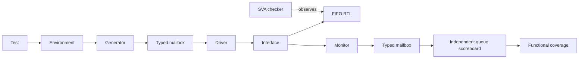

# Synchronous FIFO Design Verification

Class-based SystemVerilog verification of an 8-bit, 16-entry synchronous FIFO using an independent queue scoreboard, directed tests, seeded random stimulus, functional coverage and SystemVerilog Assertions (SVA).

## Verification results

The recorded regression ran with **QuestaSim 2021.2_1 on Linux**.

| Metric | Result |
|---|---|
| Regression | **27/27 cases PASS**: 5 fixed positive tests, 2 intentional defect-detection tests and 20 random runs |
| Random stimulus | **20 seeds**, with **500 randomized requests per seed** |
| Functional covergroup model | **22/22 bins covered (100%)** |
| Request × occupancy cross | **12/12 bins covered** |
| Reset occupancy | **3/3 bins covered** |
| Assertions | **10 assertions**, each with non-vacuous passes and **zero failures** |
| Scenario cover properties | **6/6 hit** across boundary, reset and back-to-back tests |

The 100% figure applies to the defined functional covergroup model. See [measured results](docs/verification-results.md) for the detailed metrics and [native evidence](results/README.md) for the archived reports.

## FIFO behavior

- Fixed data width of 8 bits and depth of 16 entries.
- One clock, with operations accepted at the rising edge.
- Active-low **synchronous reset**.
- Write accepted when `wr_en && !full`; read accepted when `rd_en && !empty`.
- Both acceptance decisions use the state before the clock edge.
- Registered `rdata` updates after an accepted read and holds otherwise.
- Reset clears occupancy, pointers and `rdata`, discarding pending entries; memory contents are not explicitly cleared.

When read and write are requested together:

| State before edge | Accepted operations | Occupancy after edge |
|---|---|---|
| Empty | Write only | 1 |
| 1–15 entries | Read and write | Unchanged |
| Full | Read only | 15 |

See the [specification](docs/spec.md) for requirements R01–R12.

## Verification architecture



The generator creates transactions, and the driver applies them through the interface. The monitor captures pre-edge inputs and post-update outputs. The scoreboard derives accepted operations from its own expected queue occupancy, checks FIFO ordering and output data, and compares DUT flags against the reference state.

The bound SVA checker observes DUT state and pointer movement. The environment uses SystemVerilog classes and typed mailboxes without UVM.

## Running the tests

Use a simulator supporting SystemVerilog classes, randomization, covergroups, SVA and `bind`. Load the simulator and license environment, then run commands from the repository root:

```bash
bash scripts/run.sh smoke
bash scripts/run.sh directed
bash scripts/run.sh boundary
bash scripts/run.sh reset
bash scripts/run.sh back_to_back
bash scripts/run.sh random 500 12345
bash scripts/regress.sh full
```

The `random` command above runs one seed as an example. The `full` regression runs all 20 configured random seeds.

| Regression mode | Fixed cases | Random seeds | Random requests per seed | Total cases |
|---|---|---|---|---|
| `quick` | 7 | 3 | 200 | 10 |
| `full` | 7 | 20 | 500 | 27 |

The seed list is defined in [regress.sh](scripts/regress.sh). Replaying a random run assumes the same source, configuration and simulator version.

Each run creates a fresh simulation library under `build/` and saves logs, configuration, coverage reports and waveforms under `logs/`. The scripts compile the package and its included classes in the required order.

## Test scenarios

| Test | Purpose |
|---|---|
| `smoke` | Basic module test of reset, data transfer, readout and hold behavior |
| `directed` | Class-based one-byte write/read baseline |
| `boundary` | Full/empty rejection, simultaneous requests, repeated fill/drain and pointer wrap |
| `reset` | Reset at empty, partial and full occupancy, followed by recovery traffic |
| `back_to_back` | Boundary plan with consecutive requests and no driver-inserted idle gaps |
| `random` | Seeded request/data randomization followed by a readout tail |
| `negative-full` | Detect an intentionally incorrect full threshold |
| `negative-read` | Detect intentionally corrupted read data |

The negative tests use faulty RTL variants from `negative/`. `NEGATIVE TEST PASS` means the intended defect was detected. See [defect-detection notes](docs/defect-detection.md).

## Coverage and assertions

The functional model contains:

- Four request bins: idle, write, read and both.
- Three pre-edge occupancy bins: empty, middle and full.
- Twelve request × occupancy cross bins.
- Three reset occupancy bins: empty, partial and full.

This gives **22 functional bins** in total. Middle/partial occupancy groups values 1–15 into one bin.

The ten assertions check known signals, count range, flag consistency, synchronous reset, count changes and hold behavior, `rdata` hold, and pointer movement/wrap. Six cover properties record full-write and empty-read requests, pointer-wrap conditions and reset with partial/full contents.

Boundary tests require all 12 operational cross cells to be hit. The reset test requires all three reset occupancy bins. Positive class-based tests save UCDBs; regression uses `vcover` to merge and report coverage when available. `REGRESSION TESTS PASS` confirms test outcomes, while `REGRESSION COMPLETE` confirms that the merged reports were also generated.

## Repository layout

```text
src/        FIFO RTL
tb/         Interface, transactions, classes, testbench tops and SVA checker
scripts/    Compile/run, batch Tcl and regression
negative/   Intentionally faulty RTL variants
docs/       Specification, test plan, architecture and verification results
results/    Recorded regression summary and native text reports
```

## Scope

The design is fixed at 8 bits × 16 entries. The driver applies signals on falling edges; the monitor samples outputs 1 ns after rising edges with a fixed 10 ns clock. Random tests randomize requests and data; reset scenarios are deterministic. No custom random constraints are defined.

The recorded coverage measures the specified functional model and SVA goals. RTL statement/branch coverage, parameterized configurations, clocking blocks and a UVM implementation are outside the implemented scope.

## Reading the code

Start with the [specification](docs/spec.md), then follow the [reading order](docs/reading-order.md). The [test plan](docs/testplan.md) maps each requirement to stimulus and checks.

<hr>

<p>Developed by <strong>Võ Thanh Toàn</strong><br>
University of Information Technology, VNU-HCM.</p>
